# DEAD SECTOR — playable pixel zombie shooter

A complete 2D side-scrolling arcade zombie shooter in **one HTML file (`index.html`, 1.06 MB)** — plus full **installable offline PWA** support for **GitHub Pages**. Every pixel — **6 playable gunner classes**, **8 zombie breeds**, **20 animated sector maps**, **20 named bosses**, **VFX strips**, **custom Python UI kit**, **app icons**, **WebAudio SFX**, and **physics** — is procedurally generated in Python (`Pillow`).

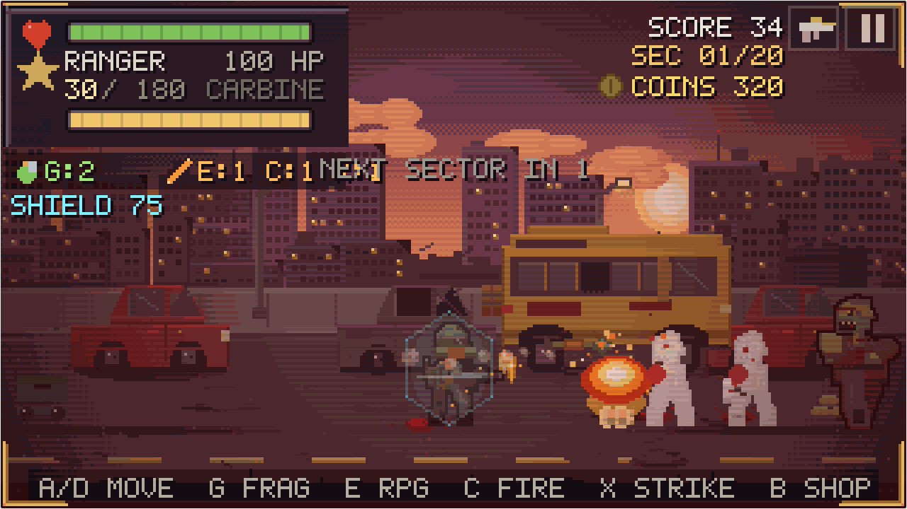

| Title & Wallet | 6 Unlockable Gunners | Gun Armory Upgrades | 20 Campaign Sectors & Bosses |
|---|---|---|---|
| 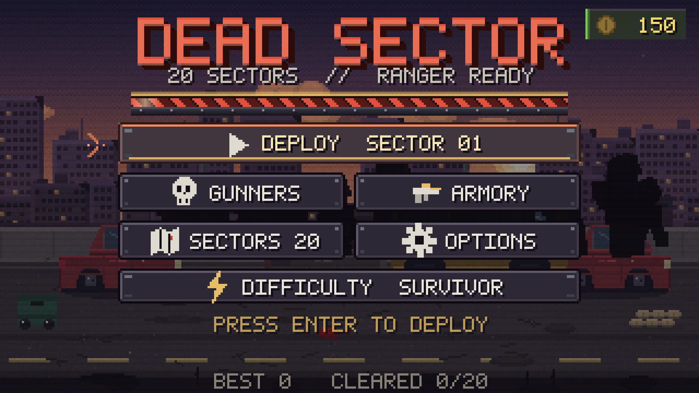 | 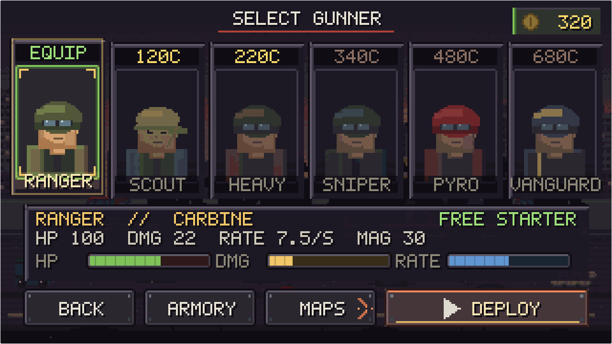 | 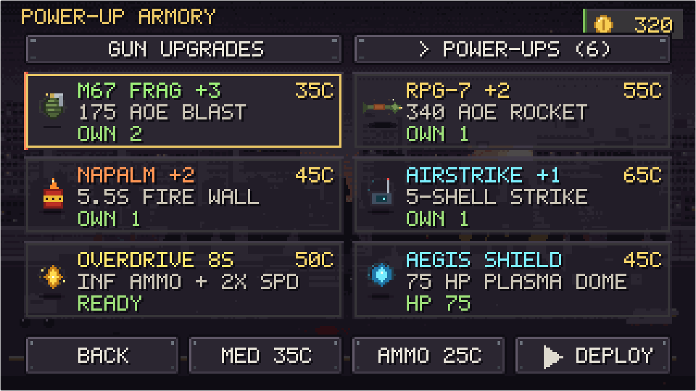 | 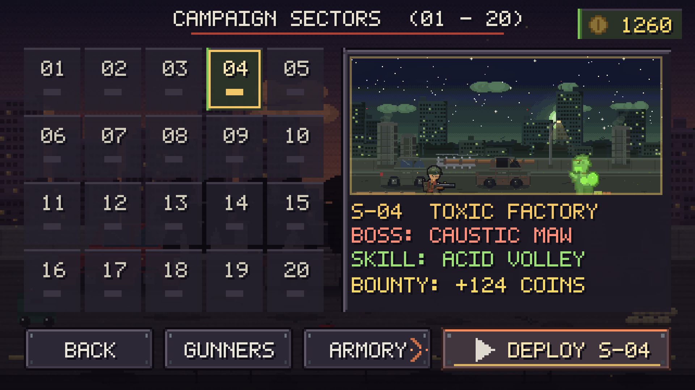 |

## Quick Deploy to GitHub Pages

1. Unzip **`dead-sector-game.zip`**.
2. Upload/push the **contents** of `dead-sector-game/` (`index.html`, `manifest.webmanifest`, `sw.js`, `favicon.ico`, `.nojekyll`, `icons/`, `assets/`, `data/`) to the root of your GitHub repository.
3. Open **Settings → Pages** → under **Build and deployment**, set **Source** to **Deploy from a branch** → select **`main`** and **`/ (root)`** → click **Save**.
4. In ~30–60 seconds your live PWA game is playable & installable at `https://<your-username>.github.io/<repo-name>/`!

## Play

* **Online:** open the GitHub Pages URL for this repo.
* **Offline:** double-click `index.html` directly from disk — single self-contained file, zero server or dependencies required.
* **Phone/tablet:** open in mobile browser, tap once for fullscreen, hold landscape. Touch controls appear automatically; all menus, gunners, armory upgrades, and 20 sector tiles work identically via **touch, mouse, or keyboard**.

## Campaign & Progression Features

* **20 Unique Maps & 20 Named Bosses:** fight from **Sector 01 — The Outskirts** (*PATIENT ZERO*) to **Sector 20 — Omega Citadel** (*THE HIVEMIND*), each with its own procedural parallax skyline, ambient animation, boss palette tint, and boss ability (`slam`, `charge`, `summon`, `acid_volley`, `blink`, `nova`, `omega`).
* **Coins & Persistent Economy:** collect golden coin drops from undead & boss showers plus wave/sector bounties to unlock operatives, permanent gun upgrades, field medkits, and ammo crates.
* **6 Buyable Gunner Operatives:** **RANGER** (*Carbine, Free*), **SCOUT** (*SMG, 120C*), **HEAVY** (*Shotgun, 220C*), **SNIPER** (*Longbow, 340C*), **PYRO** (*Hellfire LMG, 480C*), and **VANGUARD** (*Vulcan Piercing Cannon, 680C*).
* **5 Multi-Tier Gun Upgrades (`Armory` / `B` key):** **Firepower**, **Rapid Bolt**, **Drum Mag**, **Speed Loader**, and **AP Rounds** (`5` levels each), plus in-run **Medkits (`35C`)** and **Ammo Crates (`25C`)**.
* **8 Animated Zombie Varieties:** *Walker*, *Runner*, *Crawler*, *Brute*, *Acid Spitter* (arcing corrosive globs), *Riot Trooper* (body armor; headshot weakspot), *Volatile Bomber* (explosive death chain-blasts), and *Night Stalker* (shadow-blink ambushes).

## Install it as an app (PWA)

DEAD SECTOR is a real **installable, offline-first** web app. Installed, it launches
from your home screen / dock with no browser chrome, keeps its own icon, and runs
with the network switched off.

| Platform | How |
|---|---|
| **Android / Chrome** | An `INSTALL APP` chip appears bottom-right on the title screen — tap it. (Or ⋮ → *Install app*.) |
| **iOS / Safari** | Tap `ADD TO HOME SCREEN` on the title screen, or Share → *Add to Home Screen*. Runs full screen from the home screen. |
| **Desktop Chrome / Edge** | `INSTALL APP` chip on the title screen, or the install icon in the address bar. |
| **Firefox / others** | Not installable, but fully playable — the game is a single self-contained file. |

| Install prompt (desktop / Android) | iOS: add to home screen | Playing with the network off |
|---|---|---|
| 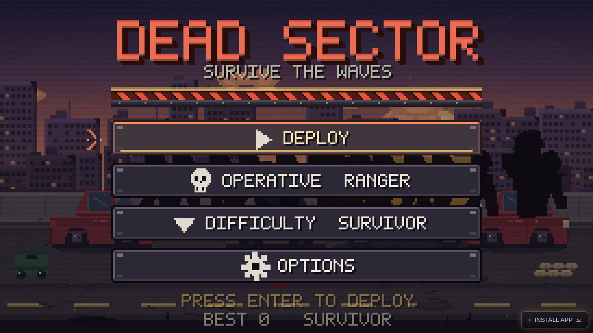 | 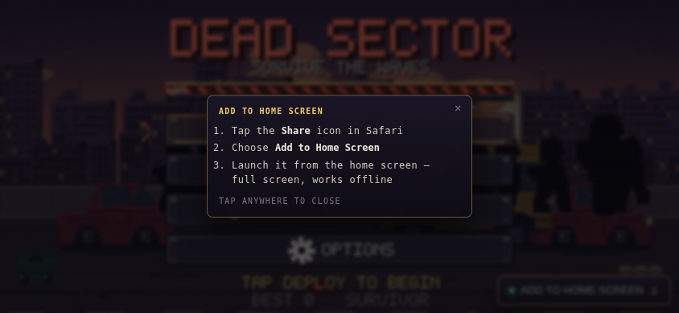 | 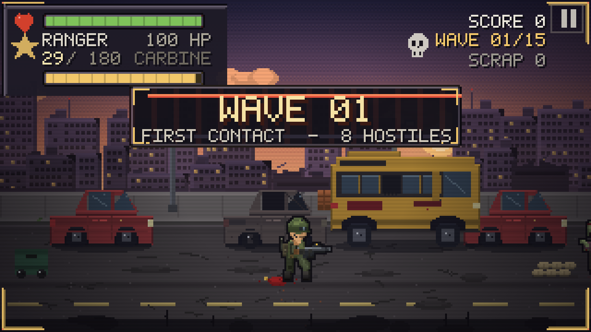 |

<p align="center">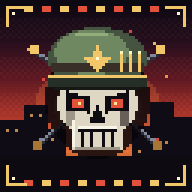</p>

How the offline part works:

* `sw.js` precaches the app shell (`index.html`, the manifest and the icons — the
  game is one file, so the whole app is **under 1 MB**, not the 9 MB of docs).
* Page loads are **network-first**: online you always get the newest build; offline
  the cached shell boots instead, so a dead signal in the metro costs you nothing.
* Every build stamps a hash of `index.html` into the cache name, so a new deploy
  replaces the old cache instead of serving you a stale game. A new build **waits**
  until you accept it: you get a `NEW BUILD — RELOAD` toast (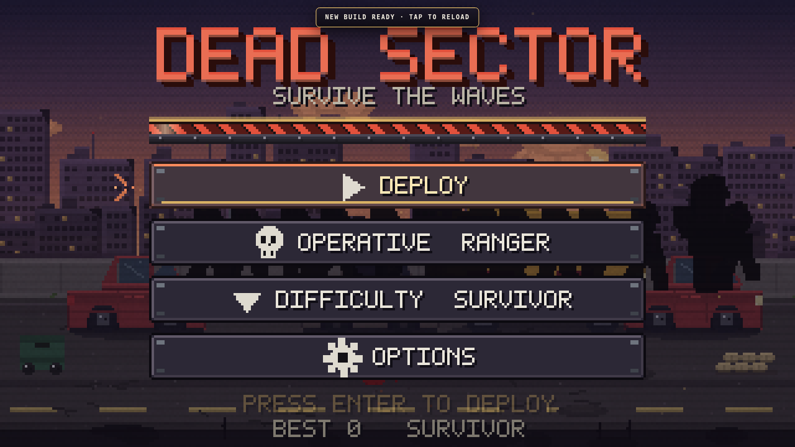),
  tap it and the page hands over to the new worker and reloads once. No half-updated tab.
* Service workers need **https** (or `localhost`) — GitHub Pages is https, so this
  works out of the box. Opening `index.html` straight from disk (`file://`) skips
  the service worker and simply plays as a normal single-file game.

### Controls

| | Desktop | Mobile |
|---|---|---|
| Move | `A` / `D` or `←` `→` | ◀ ▶ pads (bottom left) |
| Sprint | `SHIFT` | `>>` pad (above the move pads) |
| Dodge (i-frames) | `SPACE` | ✦ pad (right cluster) |
| Fire | `MOUSE` hold or `J` | big FIRE reticle pad |
| Reload | `R` | ↻ pad |
| Pause / menu | `P` / `ESC` | ⏸ button (top right) |
| Mute | `M` | Options → Sound effects |
| Menu navigation | `↑ ↓` / `W S`, `ENTER`, `ESC` | tap |
| Start / retry | `ENTER` | tap |
| Difficulty | `1`–`4` on title, or Options | Options → Difficulty |
| Toggle pads | `V` | Options → Touch pads |

Everything is available three ways — mouse, touch and keyboard — so the same
character-select card, menu row and slider responds to a tap, a click or `ENTER`.

## Feel: animation & physics

**Animation** — the playable rig is generated from a continuous gait curve
instead of hand-placed key poses:

* 12-frame walk / 10-frame run cycle with real contact, drag, lift and toe-off
  phases (the planted foot slides back at constant speed — no sliding feet);
* hips dip on weight transfer while the head counter-stabilises;
* the weapon sways one frame behind the body (inertia) and both hands are
  *solved* onto the grip / foregrip every frame;
* secondary motion off the same phase: backpack sway, antenna wobble, strap and
  cloth flutter, blinking radio LED, travelling visor glint, a periodic blink,
  and brass spat from the real ejection port on the recoil frame;
* 8-frame idle breath, 8-frame reload (drop mag, insert, slap, chamber),
  5-frame recoil chain with muzzle climb, 8-frame collapse.

**Physics** — `src/ui_js/physics.js` is a small integrator (gravity, drag,
restitution, friction, 120 Hz substeps, sleep-on-settle) used for every loose
thing in the world:

* blood **sticks** where it lands (low restitution), sparks ricochet, brass
  tumbles and rolls, gibs bounce and settle;
* pickups are rigid bodies that pop out of a corpse, bounce, then get pulled in
  by a magnet force;
* enemies take knockback from momentum transfer, blasts push bodies radially
  (`physBlast`), and the player accelerates/decelerates with mass instead of
  teleporting into a velocity;
* the camera is a spring with velocity lookahead plus trauma-based shake
  (smooth multi-frequency sway + recoil kick), and heel strikes are read from
  the animation's own event table so dust, step SFX and shake land on the exact
  frame the boot plants.

**Backdrop** — the parallax city is not a painted still; every level ships its
own ambient animation on top of the three static layers:

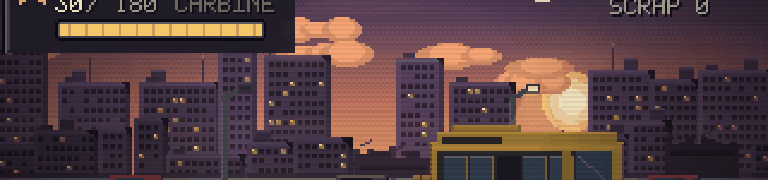

* **Window lights** — the lit windows baked into the far and mid skylines are
  harvested at generation time and re-emitted as 8-frame strips where individual
  windows switch on, stutter like a TV, or die out. The skyline flickers at a
  different rhythm from the near blocks.
* **Drifting cloud banks** and a **low mist band** scroll continuously with
  time *and* camera parallax, so the sky keeps moving while you stand still.
* **Aircraft warning beacons** — rare red lights cross the sky and blink out.
* Cost: ~60 fps held on desktop (verified 62), no per-frame allocation.

**Loot contact shadows** — dropped ammo, medkits, scrap and keys sit on a **pure
black, low-opacity** contact shadow (a wide `alpha 68` pool + a `alpha 118` core).
No tint at all: a coloured pool reads as a light source, and even a 1px colour
hint composites into a muddy smear over the black. The sprite's shadow layer now
contains *only* `rgb(0,0,0)` pixels:

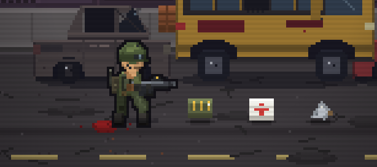

## Operatives

Three playable classes share the rig but not the feel. Pick one on the title
screen (`OPERATIVE`) or from the select screen; the choice is remembered.

| | Weapon | HP | Move | Mag | Notes |
|---|---|---|---|---|---|
| **RANGER** | carbine | 100 | 46 / 72 | 30 | balanced, no weakness |
| **SCOUT** | SMG | 88 | 54 / 86 | 36 | +18% move speed, rapid fire, lighter hits |
| **HEAVY** | shotgun | 132 | 38 / 60 | 8 | 4 pellets per trigger pull, slow |

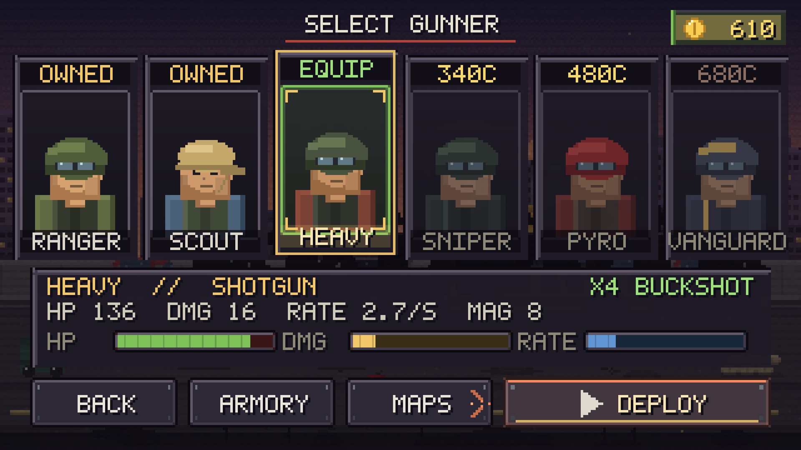

## Wave banner

The wave-intro plate is a chamfered HUD banner rather than a flat box: drop
shadow, gold hairline, scrolling hazard rails, a pulsing accent spine, rivets and
a scan sweep that travels across the plate. It drops in from above with a
left-to-right wipe and a one-frame red glitch echo on the title, carries an
`INCOMING` / `CLEARED` / `THREAT` / `DEPLOY` tag plus a sector chip, and a hairline
along the bottom drains over the banner's life so you can see how long it stays.

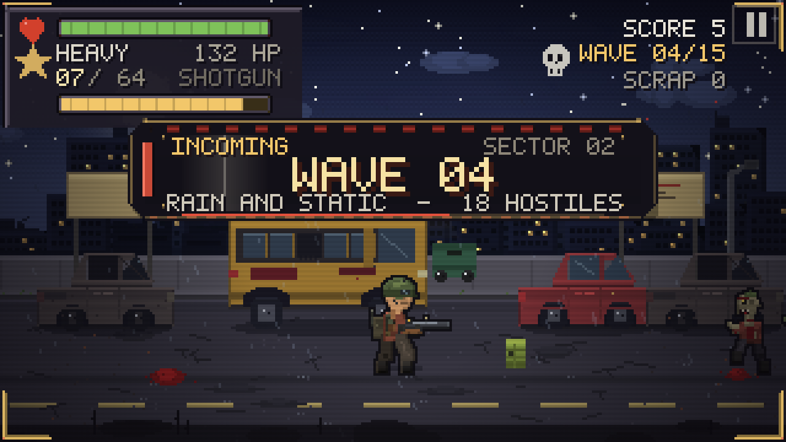

## Menus

* **Title** — logo, hazard divider, operative / difficulty / options, best score.
* **Operative select** — three portrait cards with live stat bars, perk line and blurb.
* **Options** — master volume (drag or `←/→`), sound FX, screen shake, difficulty,
  touch pads (auto/on/off), fullscreen, reset best (two-step confirm). Saved to
  `localStorage`, restored on load.
* **Pause** — resume / options / restart / quit, with run stats.
* **Results** — death and victory reports with retry, change operative, title.

All of it is drawn from a **custom UI kit generated in Python** (`src/uiassets.py`):
9-slice panels, buttons with idle/hover/pressed/disabled states, list rows, switches,
sliders, HP/ammo bars in normal/low/empty states, 16 state-animated cursors, 16 icons,
three-state class portraits, animated wave banner, scrolling hazard divider, animated
HUD corner brackets and the circular touch pads. Menus animate in (slide + fade),
buttons show a caret and a sweeping underline, the wave banner wipes in, the HUD
brackets breathe, and low health pulses the frame.

## What's in it

* **5 parallax levels** — dusk outskirts, rain-soaked downtown, quarantine checkpoint,
  toxic factory, foggy graveyard highway. Each is 3 tileable layers (0.15 / 0.45 / 1.0).
* **15 waves** with escalating hp/damage/speed, mixed spawn groups from both sides.
* **4 enemy types** — Walker, Runner (fast flanker), Brute (armored, huge), Crawler
  (low, dodges high shots).
* **3 boss fights** — Sewer King (wave 6), Vat Horror (12), The Convoy (15), each with
  its own HP bar, shockwave and enrage.
* **4 difficulty settings**, headshot bonus, pickups (ammo/medkit/scrap) with magnetism,
  blood decals, gibs, shells, dust, hitstop, screenshake, muzzle light, corpse fade,
  best-score saving, pause/game-over/victory screens.
* **Procedural WebAudio SFX** — gunshots, groans, explosions, pickups, footsteps. No audio files.
* **Real physics** for blood, brass, gibs, pickups, ragdolls, blasts and camera shake.

## Multi-device

The world is 180 units tall; the **visible width follows the device aspect ratio**, so
phones, tablets, 16:9 and 21:10 ultrawide all fill the screen instead of letterboxing
(wide screens simply show more level). DPR-aware rendering, safe-area insets for
notches, pinch/scroll/zoom disabled, one-tap fullscreen with best-effort landscape lock.
Portrait shows a "rotate your device" hint.

## Repo layout

```
index.html          the game (self-contained, ~0.5 MB)
assets/
  sprites/          character atlases (+json), animation strips, props, vfx
  scenes/           per-level parallax layers and flattened previews
  animations/       animated GIF previews of every animation
  art/              key art, title screen, title backdrop
  ui/               the generated UI kit (panels, buttons, rows, switches, bars,
                    icons, portraits, banners, touch pads) + ui.json index
  screenshots/      device + gameplay captures
data/               waves.json (levels, waves, enemy stats), players.json (roster)
manifest.json       anchors, fps, atlas rects, per-frame muzzle table
manifest.webmanifest  PWA manifest (name, icons, standalone, landscape)
sw.js               service worker: offline cache, network-first shell
icons/              procedurally drawn app icons (192/512 + maskable + apple-touch)
GUIDE.md            how the art/game are put together and how to change them
```

`index.html` does not reference `assets/` at runtime — the folder is there so you can
reuse the art in Unity/Godot/Phaser, inspect it, or rebuild sheets.

## Publish on GitHub Pages

```bash
git init
git add .
git commit -m "DEAD SECTOR"
git branch -M main
git remote add origin https://github.com/<you>/<repo>.git
git push -u origin main
```
Then **Settings → Pages → Build and deployment → Deploy from a branch → main / (root)**.
Your game is live at `https://<you>.github.io/<repo>/`. `.nojekyll` is included, and
because every PWA URL is relative, install + offline work at a domain root *and* under
the `/repo/` sub-path without edits. First visit installs the cache; after that the
page loads straight from it.

## Licence

MIT for the code (see `LICENSE`). All art here was generated procedurally for this
project — no third-party assets — so you can use, modify and ship it freely.
